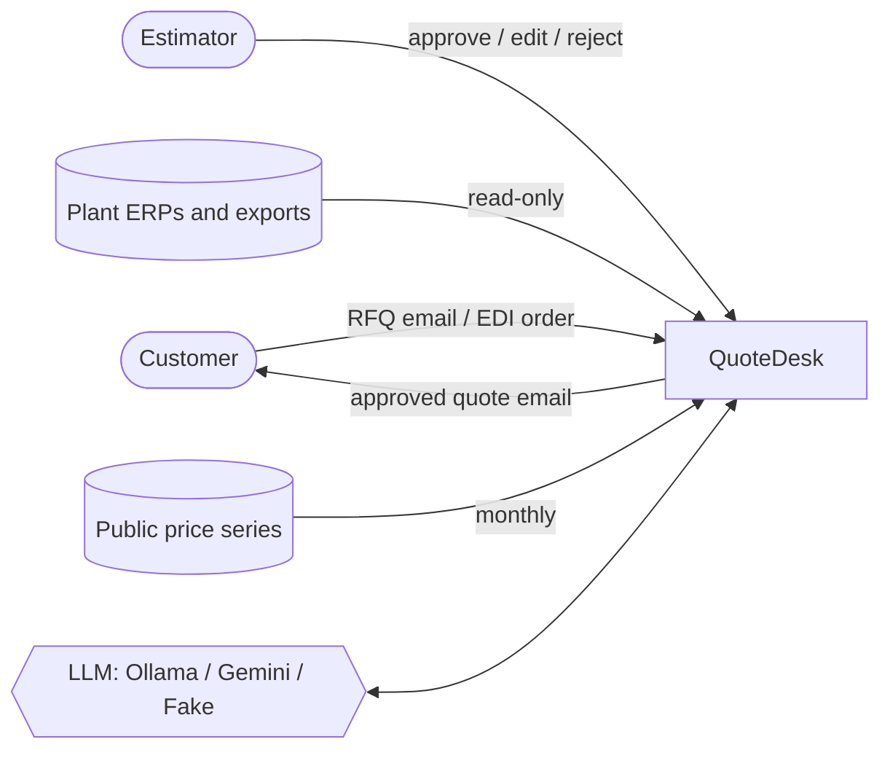
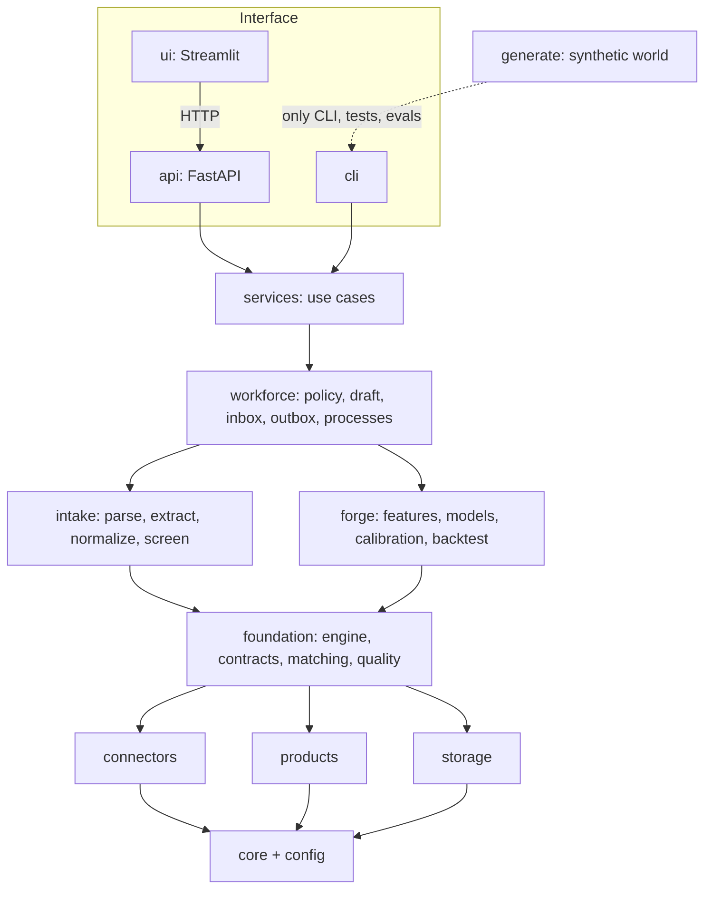

# QuoteDesk architecture

A light arc42-style description: context, building blocks, runtime flow, data,
cross-cutting concerns, and risks. Decisions and their reasons are in `docs/adr/`.

## 1. Goals and constraints

| Goal | What it means here |
|---|---|
| Trustworthy | every number has a baseline and a label; every action is recorded; humans approve sends |
| Generic | a new data source or product family is configuration, not engine changes |
| Explainable | one developer can explain every line; simple code over clever code |
| Runs anywhere | local open models (Ollama) or a hosted model (Gemini) or a scripted fake |

Constraints: Python 3.12 + uv; SQLite; no agent frameworks; all company data synthetic.

## 2. Context



## 3. Building blocks



### Dependency rules (checked by import-linter in CI)

1. **Layers:** a module may import only from layers below it in the diagram.
2. **Independence:** `intake` and `forge` never import each other.
3. **Forbidden:** no product package imports `quote_desk.generate`. The model must
   learn cost from data, never from the generator's formulas.
4. `ui` imports nothing from `quote_desk`; it only calls the API.

### Responsibilities

| Package | Owns | Does not |
|---|---|---|
| `core` | Money, ids, `Clock` protocol, shared Pydantic types | any I/O |
| `connectors` | turning a file into text-only DataFrames with source locators | cleaning |
| `products` | per-family config schema, synonyms, feature list (a registry dict) | pricing logic |
| `foundation` | contracts, cleaning, canonical model, matching, quality, lineage | business decisions |
| `forge` | should-cost, models, calibration, similar jobs, drivers, backtest, model registry | reading raw sources |
| `intake` | email → validated `RFQRequest` with field statuses | pricing or sending |
| `workforce` | policy, drafts, inbox events, outbox, processes over time | calling the LLM on raw email for drafting |
| `services` | orchestrating one use case per function | holding rules |
| `storage` | migrations (numbered SQL + `PRAGMA user_version`), repositories | business rules |

### Ports and fakes

Only where something real sits on the other side:

| Port | Real | Fake (tests, keyless demo) |
|---|---|---|
| `LLMClient` | Gemini, Ollama | scripted responses keyed by prompt id |
| `SourceReader` | one per format | in-memory tables |
| `Clock` | system time | settable simulated clock |
| `Mailer` | writes to outbox file / log | in-memory list |

## 4. Runtime: one RFQ

```mermaid
sequenceDiagram
  participant E as Email
  participant I as Intake
  participant F as Forge
  participant W as Workforce
  participant H as Estimator
  E->>I: .eml + attachments
  I->>I: parse → extract (LLM, validate, re-ask ≤2) → normalize → screen
  I->>W: RFQRequest + field statuses + flags
  W->>F: price each line
  F-->>W: P10/P50/P90, lead time, similar jobs, drivers
  W->>W: draft quote + reply (no raw email), apply policy → rule ids
  W->>H: inbox item (pending / needs senior / flagged)
  H->>W: approve / edit / reject (+ reason)
  W->>W: event appended (hash-chained); approved → outbox
```

Processes over time are a pure `step(state, event) -> (state, actions)` function per
quote, driven by the `Clock`: `tick` emits follow-up and expiry events; `reprice`
emits price-change events. Every side effect carries an idempotency key.

## 5. Data

| Store | Written by | Contents |
|---|---|---|
| `data/raw/` (committed) | `fetch-commodities` | real public price series |
| `erp_north.sqlite`, `south/` exports | `generate` | the messy synthetic sources (read-only afterwards) |
| hidden truth folder | `generate` | error ledger, true links, true cost drivers (evals only) |
| `foundation.sqlite` | `foundation` | cleaned and canonical tables, `audit`, `quarantine`, `review_queue`, `crosswalk`, `runs` |
| `models/<id>/` | `forge` | model files, calibration, features, data hash, metrics, model card; `registry.json` |
| `app.sqlite` | `workforce`, `intake` | `events` (append-only, hash chain), `quotes` (current state), `outbox`, `llm_calls`, traces |

## 6. Cross-cutting concerns

- **Configuration:** `config.py` with pydantic-settings; secrets as `SecretStr`.
- **Logging:** JSON lines with a request id.
- **LLM tracing:** `llm_calls` uses OpenTelemetry GenAI field names
  (`gen_ai.provider.name`, `gen_ai.request.model`, `gen_ai.usage.input_tokens`, ...)
  so it can be exported later without renaming.
- **Determinism:** seeds everywhere; reruns give identical outputs (tested).
- **Number labels:** Measured / Derived / Projected on every reported metric.

## 7. Testing strategy

| Kind | Where |
|---|---|
| Unit tests on pure functions | every module |
| Property tests (Hypothesis) | cleaning: idempotent, rows conserved (kept + quarantined = in), unique keys after, unit round-trips |
| Shared suites | every connector and every `LLMClient` must pass the same tests |
| Golden files (syrupy) | quality report, model card, draft email |
| ML tests (after Breck et al., ML Test Score) | beats baseline, per-slice quality, reproducible, no train/serve skew, promotion gate |
| Security tests | attack emails with the Fake: flagged, never drafted to send |
| End to end | email → inbox item, in CI with the Fake |
| Live evals | marked `live`, run manually with real models, never in CI |

CI: setup-uv → `uv sync --locked` → ruff format check → ruff check → mypy →
lint-imports → `pytest -m "not live" --cov` → docker build.

## 8. Threat model (LLM-specific)

| Risk (OWASP LLM 2025) | Where | Control | Test |
|---|---|---|---|
| LLM01 Prompt injection | email body, attachments | extractor has no tools, typed output only; drafter never sees raw email; flags on suspicious text | attack emails never reach "drafted" |
| LLM02 Sensitive data disclosure | reply email | reply built from template + approved fields; costs and margins never in customer text | draft contains no cost/margin fields |
| LLM05 Improper output handling | extracted fields | Pydantic validation, catalog match in code | invalid output re-asked, then flagged |
| LLM06 Excessive agency | sending, payments | outbox only from approval events; payment changes never actionable | property test: no send without approval |
| LLM10 Unbounded consumption | retries, long inputs | max 2 re-asks; input truncation for small models; per-call token log | retry cap test |
| Business email compromise | bank-detail change | always flagged; verify by phone on file | fake bank email lands in "flagged" |

## 9. Deployment

One Docker image (uv multi-stage build, user id 1000). Streamlit on port 7860 (public),
FastAPI on 127.0.0.1:8000 (internal), one start script. On a Hugging Face Space the
data is regenerated at start and the inbox is a resettable demo. The same image runs
offline with a local Ollama.

## 10. Known risks and limits

- Synthetic data: the generator's cost structure is known to its author; mitigated by
  hidden truth, import rules, and learnability checks, but not eliminated.
- Small eval sets: intervals on accuracy numbers are reported.
- Conformal coverage is an average guarantee and assumes the past resembles the
  future; drift (the copper rally) is measured, not assumed away.
