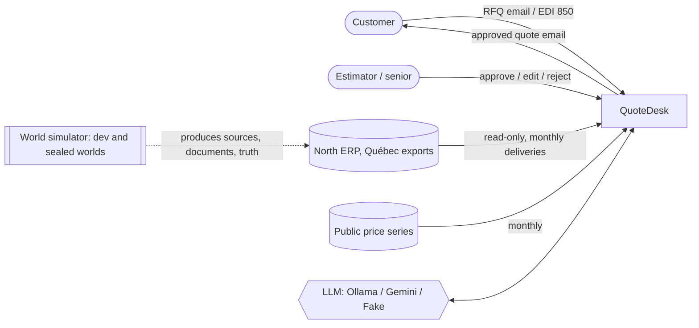
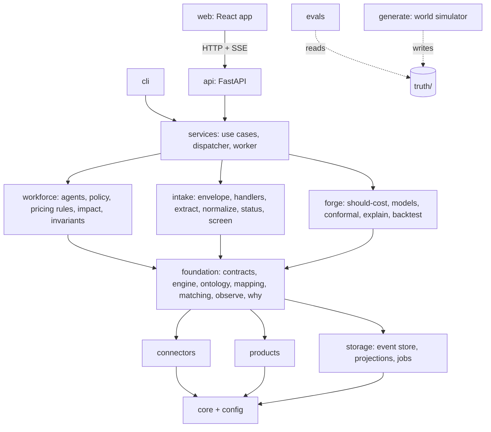
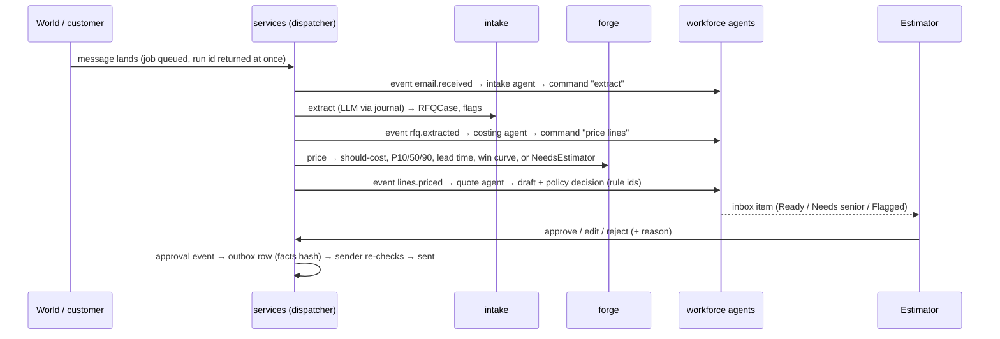

# QuoteDesk architecture

A light arc42-style description: goals, context, building blocks, runtime, data,
cross-cutting concerns, testing, threats, deployment. Decisions and their reasons are in
`docs/adr/`. The build plan is in `SPEC.md`.

## 1. Goals and constraints

| Goal | What it means here |
|---|---|
| Trustworthy | every number has a baseline, a CI and an M/D/P label; every action is recorded; humans approve sends |
| Generic | a new source is a contract + mappings; a new family is a `products/` module; no engine changes |
| Explainable | one developer can explain every line; plain loops and tables over frameworks |
| Runs anywhere | local open models (Ollama), a hosted model (Gemini), or a scripted fake |

Constraints: Python 3.12 + uv; SQLite and DuckDB files, no servers; no agent frameworks;
all company data synthetic.

## 2. Context

The world simulator stands in for the customer's reality. It is outside the product: it
writes the sources and documents, keeps the answer key in `truth/`, and answers outgoing
emails during simulation.

## 3. Building blocks

### Dependency rules (import-linter, checked in CI)
1. **Layers:** `api → services → {workforce, intake, forge} → foundation →
   {connectors, products, storage} → {core, config}`.
2. **Independence:** `workforce`, `intake` and `forge` never import each other. Agents
   return *commands* ("extract this message", "price this line", "stage this email");
   `services` executes them. This keeps agents pure and testable.
3. **Forbidden:** no product package imports `quote_desk.generate` or `quote_desk.evals`,
   and nothing in the product reads `truth/`. Only `evals/` and tests may.
4. `web/` talks to the API only; TypeScript types are generated from the OpenAPI schema.

### Responsibilities

| Package | Owns | Does not |
|---|---|---|
| `core` | Money, Provenance, Metric, event type union, Clock protocol | I/O |
| `connectors` | file → text-only DataFrames with source locators and file hash | cleaning |
| `products` | per-family config schema, en/fr synonyms, standard ratings | pricing |
| `storage` | app.sqlite migrations, event store, projections, jobs, journal, outbox | business rules |
| `foundation` | contracts, cleaning, ontology, mapping, matching, observability, `why` | business decisions |
| `forge` | should-cost, cost / lead-time / win models, conformal, abstain, explain, backtest, registry | reading raw sources |
| `intake` | message → `RFQCase` with field values, statuses, provenance, flags | pricing, sending |
| `workforce` | agents' `handle(event, view) → commands`, policy decisions, pricing rules, impact, invariants | I/O, LLM calls |
| `services` | dispatcher, worker, use cases; executes commands; the only place layers meet | holding rules |
| `api` | HTTP + SSE, Pydantic in/out | logic |

### Ports and fakes

| Port | Real | Fake |
|---|---|---|
| `LLMClient` | Gemini, Ollama | scripted responses keyed by prompt id and input hash |
| `SourceReader` | one per format | in-memory tables |
| `Clock` | system time | persisted simulated clock |
| `Mailer` | writes to outbox delivery log / world inbox | in-memory list |

## 4. Runtime

### 4.1 One RFQ

Each step appends events in the same transaction as its projections; the web app follows
the run over SSE.

### 4.2 Agents over time
The dispatcher loop picks the earliest of (next due timer, next unconsumed event for any
agent), ordered by (simulated time, position, agent name). In one transaction it runs the
agent, executes its commands, appends events, inserts timers and outbox rows, and moves the
agent's cursor. LLM calls and sends go through a journal keyed by idempotency key, so a
crash at any point never repeats a side effect. `sim fuzz` crashes the loop at named points
over 200 seeds and an independent invariant checker must find no violation.

### 4.3 Onboarding a source
Upload → detect format → profile → candidate mappings → LLM rerank (typed
`ColumnMapping`, transform chosen by name) → human review → dry run → publish
(`publish_contract` action event) → load → matching → scorecard. Each stage emits progress
events to the UI.

## 5. Data

| Store | Written by | Contents |
|---|---|---|
| `data/raw/` (committed) | `fetch-series` | real public series + provenance |
| `data/generated/world/<seed>/` | `generate` | North ERP sqlite, Québec monthly exports, EDI and email documents, OCEL log |
| `data/generated/world/<seed>/truth/` | `generate` | latent traits, causes, cost decomposition, crosswalk, error ledger, document labels |
| `foundation.duckdb` | `foundation` | cleaned tables, `obj_*`/`link_*`, deliveries, runs, metrics, incidents, match pairs, crosswalk, mapping proposals, audit, quarantine |
| `models/<id>/` | `forge` | models, calibration, features, data hash, metrics, model card; `registry.json` |
| `app.sqlite` | `storage` via `services` | `events` (global position, per-stream seq, hash chain, append-only), projections, `jobs`, `timers`, `cursors`, `journal`, `outbox`, `decisions`, `llm_calls` |
| checkpoint file (outside the db) | `audit checkpoint` | chain head hashes, so a full rewrite is detected |

DuckDB for Foundation's analytical work (joins, history, multi-format reads); SQLite for the
app's many small transactions and append-only triggers (ADRs 0005, 0011).

## 6. Cross-cutting concerns

- **Configuration:** `config.py` with pydantic-settings; secrets as `SecretStr`.
- **Events:** Pydantic discriminated union in `core/events.py`, versioned (`schema_v`);
  the same models generate the TypeScript types.
- **LLM tracing:** `llm_calls` with OpenTelemetry GenAI field names (provider, model,
  input/output tokens, latency, attempts, validation errors, prompt version).
- **Determinism:** seeded streams per entity; LLM results cached by input hash; replays
  of the same seed give the same chain head.
- **Number labels:** every reported number is a `Metric` with CI, n and M/D/P label.

## 7. Testing strategy

| Kind | Where |
|---|---|
| Unit tests on pure functions | every module |
| Property tests (Hypothesis) | cleaning (idempotent, rows conserved, unique keys, unit round-trips); policy (forbid wins, default deny); outbox (never filled without approval, stateful) |
| Shared suites | every connector and every `LLMClient` pass the same tests |
| Golden files | quality report, model card, draft email |
| ML tests (ML Test Score subset) | beats baselines with paired CIs, per-slice coverage, reproducibility, no train/serve skew, leakage, promotion gate |
| Simulation tests | `sim fuzz` invariants; same seed → same chain head; projections rebuild == live |
| Security tests | attack emails with clean twins: 0 consequential actions |
| Frontend | Vitest for pure helpers; freshness tests for every committed number; OpenAPI → TS drift check; 3 Playwright flows |
| Mutation checks | each rule broken in turn (own script); every mutant must be caught |
| Live evals | marked `live`, run manually with real models, never in CI |

CI: setup-uv → `uv sync --locked` → ruff → mypy → lint-imports → `pytest -m "not live"`
→ frontend tsc + vitest + build → docker build.

## 8. Threat model (LLM-specific)

| Risk (OWASP LLM 2025) | Where | Control | Test |
|---|---|---|---|
| LLM01 Prompt injection | email bodies, PDFs, sheets | extractor has no tools, typed output only; drafter never sees raw email; flags on suspicious text | attack suite: 0 consequential actions; field integrity vs clean twin |
| LLM02 Sensitive data disclosure | reply email | reply from template + approved fields; cost and margin never in customer text | draft contains no cost/margin fields |
| LLM05 Improper output handling | extracted fields, column mappings | Pydantic validation; transforms chosen by name from a registry; catalog match in code | invalid output re-asked then flagged |
| LLM06 Excessive agency | sending, payments, approvals | outbox only from a fresh approval event; agents cannot approve; financial tier forbidden | `sim fuzz` invariants, property test |
| LLM10 Unbounded consumption | retries, long inputs | max 2 re-asks; input limits for small models; token log | retry cap test |
| Business email compromise | bank-detail change, look-alike domain | always flagged; verify by phone using the number on file | fraud email lands in Flagged with no send action |
| Log tampering | `events` | append-only triggers, hash chain, external checkpoint | `audit verify` finds the first bad event; full rewrite fails the checkpoint |

## 9. Deployment

One Docker image (uv multi-stage, user id 1000): uvicorn serves `/api/*` and the built
React app on port 7860. Data, models and the recorded replay are baked at build time; boot
does no generation or training. The public Space uses the Fake provider by default and a
live model behind a per-visitor gate. On-prem: a compose file with the app and the
official Ollama image; `bench-llm` writes a Measured latency table with the machine's
details.

## 10. Known risks and limits

- Synthetic data: the author wrote the world. Mitigated by the sealed world (different
  seed, perturbation chosen by a separate agent), import rules, pre-registration and
  learnability checks; not eliminated.
- Simulated approvers: workforce metrics are labeled "Measured in simulation".
- Conformal coverage is an average guarantee; per-family and per-configuration coverage
  are measured, drift is measured, not assumed away.
- Small eval sets: every number carries its CI.
